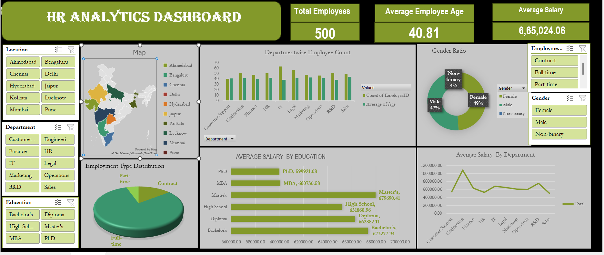

# HR Analytics Dashboard (Excel Project)

**Overview**:
The primary goal of this project is to analyze and visualize key human resource metrics to support data-driven decision-making. By transforming raw workforce data into an interactive Excel dashboard, this project provides actionable insights into employee demographicS and departmental performance, helping the organization reduce turnover and optimize workforce planning.

**Contents**:
1. **Data Sheet:**: The analysis is based on a human resources dataset containing records.
2. **Demographics:**: Age, Gender, Education Field, Marital Status.
3. **Employment Details:**: Employee ID, Department, Job Role, Employment Type.
4. **Performance & Metrics:**: Job Satisfaction, Performance Score.

**How to Use**:
1. **Download**: Download the Excel file from this repository.
2. **Data Input**: Input your own sales data into the "Data Sheet" or replace existing data.
3. **Analysis**: Navigate through different sheets to analyze various aspects of your HR Analytics Dashboard.
4. **Charts**: Charts and graphs are dynamically linked to the data. Simply update the data, and the charts will update automatically.

**Requirements** : 

Microsoft Excel 

**Contributing**:

Contributions are welcome! If you have any suggestions for improving the analysis or adding new features, feel free to fork this repository, make your changes, and submit a pull request.

**Acknowledgments**:

- Inspiration: "This analysis was inspired by the need for a better understanding of workforce productivity trends and talent performance."
- Data Source: 

**Feedback**:

If you have any feedback, questions, or concerns, please feel free to open an issue in this repository or contact ME at bhartisonawane30@gmail.com.

Thank you for using HR Analysis Excel! Enjoy analyzing your sales data and discovering insights to improve your business.
